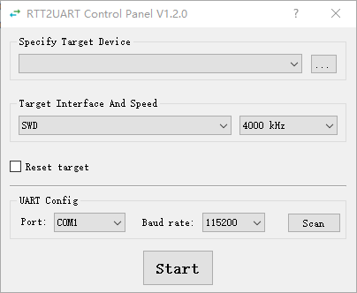

# RTT2UART

RTT2UART is a desktop bridge between J-Link RTT and a host serial application.
Use a virtual COM port pair to exchange target data with an existing serial
terminal or serial-based tool through the target's debug connection.

```text
Target firmware with RTT
        | debug connection
     J-Link
        | local RTT TCP endpoint: localhost:19021
     RTT2UART
        | COM4 (example)
Virtual COM port pair
        | COM5 (example)
Serial application

Data can flow in both directions.
```

The COM ports are on the host. The target communicates through RTT; this workflow
does not require a target UART connection. Target firmware must already provide
RTT output and, for sending data to the target, an RTT input handler.



The repository screenshots illustrate the workflow; their layout may differ
from the application version you run.

## Start here

1. Download and extract the Windows package from
   [GitHub Releases](https://github.com/tianxiaoMCU/RTT2UART/releases).
2. Install the J-Link software and a virtual serial port tool, then create a
   virtual COM port pair.
3. Follow [Getting started](./docs/getting-started.md) to connect over USB and
   verify each direction of data transfer.

Keep the extracted package together and launch it from its directory. The
current source uses files in the working directory for the device database,
J-Link command file, and saved settings. See the guide for prerequisites and
package verification limits.

## Documentation

| Document | Use it to |
| --- | --- |
| [Getting started](./docs/getting-started.md) | Prepare Windows, make the first connection, use Existing Session, and troubleshoot common failures |
| [Development](./docs/development.md) | Install source dependencies, regenerate the UI, package the program, and record validation |
| [Architecture](./docs/architecture.md) | Understand connection ownership, byte forwarding, settings, and reconnect limits |
| [Glossary](./GLOSSARY.md) | Use consistent terms for the target, RTT endpoint, and serial applications |

## Connection modes and boundaries

| Mode | Current source behavior |
| --- | --- |
| USB | Opens a J-Link probe, configures the target connection, and attaches to the local RTT endpoint |
| Existing Session | Attaches to an RTT endpoint provided by another local J-Link session; offers limited socket reconnection |
| TCP/IP | Disabled in the current GUI |

Both enabled modes connect to `localhost:19021`. The application has no GUI
setting for another RTT host, port, or channel. Existing Session still requires
a discoverable J-Link runtime when the application starts.

Windows is the documented workflow. Linux/macOS operation, target/probe
compatibility, and throughput have not been established by this documentation
review. An interface or device appearing in a list is not a compatibility test.

## License

RTT2UART is distributed under the [MIT License](./LICENSE).
