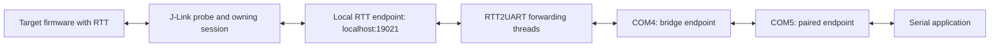

# Architecture

[Project overview](../README.md) | [Getting started](./getting-started.md) | [Development](./development.md) | [Glossary](../GLOSSARY.md)

This document explains the current source behavior reviewed at commit `99df508`.
It describes implementation and its limits, rather than a proposed redesign or
a hardware compatibility claim.

## Components and data flow

COM4 and COM5 are example names for one virtual COM port pair. The probe/session
exposes the RTT endpoint, and RTT2UART acts as its TCP client. RTT2UART does not
implement the endpoint's server or the target's RTT firmware.

| Component | Responsibility | Source |
| --- | --- | --- |
| `MainWindow` | Collect configuration, create the J-Link object, start/stop a bridge, and save selection history | [`main_window.py`](../main_window.py) |
| `DeviceSeleteDialog` / `DeviceTableModel` | Load the XML device list and expose target selection | [`main_window.py`](../main_window.py) |
| `rtt_to_serial` | Own the serial handle, TCP socket, forwarding threads, and reconnect timer; manage the probe in USB mode | [`rtt2uart.py`](../rtt2uart.py) |
| Generated UI/resource modules | Construct the Qt widgets and provide the compiled icon | [`ui_rtt2uart.py`](../ui_rtt2uart.py), [`ui_sel_device.py`](../ui_sel_device.py), [`rc_icons.py`](../rc_icons.py) |
| J-Link Commander script | Export `JLinkDevicesBuildIn.xml` into the working directory | [`JLinkCommandFile.jlink`](../JLinkCommandFile.jlink) |

## Connection ownership

| Concern | USB | Existing Session |
| --- | --- | --- |
| Probe connection | RTT2UART opens the probe when the J-Link object is not already connected | Owned by an external J-Link application |
| Target/interface/speed | Selected in RTT2UART and passed to J-Link during connection | Selected in the owning application; corresponding GUI controls are disabled |
| Reset | Optional `reset(halt=False)` request in the USB connection path | Disabled and unchecked |
| RTT TCP endpoint | RTT2UART connects to `localhost:19021` after target/serial setup | Same address, supplied by the existing session |
| Reconnect option | Hidden | Visible; limited socket recovery |
| Probe cleanup | Attempts `rtt_stop()` and `close()` if connected | Does not close the external probe session |

Both modes still instantiate `pylink.JLink()` when the GUI starts. Existing
Session bypasses probe setup in the bridge, but it does not bypass this startup
dependency on a discoverable J-Link library.

The generated UI disables the TCP/IP radio button and address input. Backend
code that can pass an IP address to J-Link does not make remote-probe connection
an enabled GUI feature.

## Startup sequence

The GUI entry point creates a local Qt server as a single-instance guard, then
constructs `MainWindow`. Initialization populates controls, scans serial ports,
loads saved selections if present, creates a J-Link object, and attempts the
Windows device-list export.

When Start is clicked, `MainWindow.start()` gathers parameters and calls
`rtt_to_serial.start()`:

1. For a non-Existing connection whose J-Link object is not already connected,
   open the probe. The USB path optionally passes its serial number.
2. Set the debug speed and interface. If reset is selected, call
   `reset(halt=False)`, then call `connect(device)`.
3. Assign the selected serial port and baud rate, set read and write timeouts
   to 3 seconds, and open the serial port.
4. Open an IPv4 TCP socket to `localhost:19021`.
5. If the socket connects, set the worker flag and start two daemon threads.
   Otherwise, raise `Connect or config RTT server failed`.

The backend contains no explicit `rtt_start()` call, RTT control-block search,
or channel selection. The source alone therefore does not establish how every
J-Link runtime/firmware combination initializes RTT or maps buffers to the TCP
endpoint. A working endpoint for the intended target is a prerequisite to
successful forwarding.

After initial success, the GUI sets its own `start_state` and changes the button
text to Stop. A worker failure does not automatically clear that state or
report through a GUI signal. A startup exception displays a dialog, but the
error path does not consistently restore disabled controls or explicitly roll
back all partially opened resources.

## Byte forwarding

| Direction | Worker | Operation |
| --- | --- | --- |
| RTT endpoint to serial | `rtt_to_uart()` | Read up to 1024 bytes from the socket and pass received bytes to `serial.write()` |
| Serial to RTT endpoint | `uart_to_rtt()` | Read waiting serial bytes, or wait for one byte, and pass them to `socket.sendall()` under a write lock |

The bridge does not decode text, add line endings, parse commands, define packet
boundaries, or select RTT channels. TCP read boundaries are not application
message boundaries. Encoding, framing, and target command handling belong to
the serial application, the external RTT path, and the firmware.

The selected serial baud rate is independent of the debug-interface speed.
The GUI's first-run defaults are SWD, 4000 kHz, and 115200 baud when no settings
file exists. The backend constructor independently defaults to 12000 kHz; the
GUI passes its selected speed explicitly. Other serial format and flow-control
settings are inherited from `serial.Serial()` defaults.

Raw forwarding in these workers does not establish end-to-end binary
transparency, lossless delivery, latency, or throughput for the external RTT
server and virtual-port driver. Those properties require separate tests.

## Reconnect behavior

In Existing Session, the Auto Reconnect checkbox supplies a Boolean as the
connection parameter. Recovery starts only when an established socket's
`recv()` returns `b''` and that parameter equals `True`.

1. Clear the worker flag, close the socket, and schedule a callback after
   0.5 seconds.
2. The callback attempts a new connection to `localhost:19021`.
3. On success, join the previous threads for up to 0.5 seconds each, set the
   flag, and create new forwarding threads.
4. On failure, schedule the next callback after 1 second.

These values are timer delays; socket connection time is additional. No socket
connect timeout is explicitly configured by this code.

The retry path keeps the existing serial handle and does not reinitialize the
probe or target. It does not run after a failed initial connection. Socket
exceptions and serial failures generally raise within workers rather than
entering this loop. With reconnect disabled, a clean socket closure also has
no explicit user-facing recovery transition. This is limited endpoint recovery,
with no guarantee that data survives an interruption.

## Stop and close

`stop()` cancels the current retry timer, clears the worker flag, and joins each
worker for up to 0.5 seconds. It then attempts probe cleanup in USB mode, closes
the serial port, and closes the socket. These bounded joins do not prove that
all blocking worker operations have finished before cleanup continues.

Closing the window calls stop when the GUI considers the bridge started, then
saves selections. Existing Session leaves probe ownership with the external
application. Stop the bridge before changing connection mode; the current GUI
is not a complete session-state or transport-health monitor.

## Settings and startup files

| File | Location | Behavior |
| --- | --- | --- |
| `settings` | Current working directory | Binary pickle loaded on startup and saved on window close |
| `JLinkCommandFile.jlink` | Current working directory | Passed to Commander during the Windows export attempt |
| `JLinkDevicesBuildIn.xml` | Current working directory | Read by the device selector; exported/refreshed by Commander |

Saved settings include target history, target index, interface index, speed
index, serial-port index, and baud-rate index. They do not save connection mode,
probe serial number, reset selection, or the Auto Reconnect selection. USB is
selected and Auto Reconnect is checked during initialization. Because the COM
selection is an index, a changed port list can change the port selected after a
restart; verify it before starting.

On Windows, the export path finds the loaded J-Link library's directory,
replaces the process `PATH` with that directory, and runs
`JLink.exe -CommandFile JLinkCommandFile.jlink`. The script exports the XML and
exits. Export errors are logged, allowing an existing XML file to remain the
selector's input. There is no fallback search for another database location.

The Linux/macOS branches construct a Commander command string without executing
it. Their presence does not demonstrate a working cross-platform startup path.

## Verification boundary

The descriptions above are based on source and configuration inspection. No
GUI launch, dependency installation, package execution, probe connection, target
traffic, or reconnect fault test was performed for this documentation change.
Use the [validation checklist](./development.md#validation-checklist) to record
results for a specific source revision or release asset and hardware setup.
