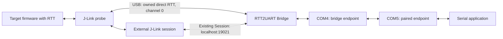

# Architecture

[Project overview](../README.md) | [Getting started](./getting-started.md) | [Development](./development.md) | [Glossary](../GLOSSARY.md)

Both USB and Existing Session use the Qt-independent lifecycle in `rtt2uart.py`.
See [Lifecycle migration](./lifecycle-migration.md) for ownership, deadlines,
public interfaces, and automated evidence.

## Components and data flow

The two probe paths represent alternative modes. A USB run consumes no TCP RTT
data. COM4 and COM5 are example names for one virtual COM port pair. RTT2UART
implements neither the external endpoint server nor the Target firmware.

| Component | Responsibility | Source |
| --- | --- | --- |
| `MainWindow` | Freeze run configuration, request start/stop, render snapshots, save selection history | [`main_window.py`](../main_window.py) |
| `DeviceSeleteDialog` / `DeviceTableModel` | Load the XML device list and expose Target selection | [`main_window.py`](../main_window.py) |
| `Bridge` | Own startup, forwarding, recovery in both modes, serial draining, cancellation, and cleanup | [`rtt2uart.py`](../rtt2uart.py) |
| `USBChannel` / `USBConfig` | Own a fresh probe session, enforce identity, prepare Target/RTT, serialize native I/O and release | [`usb_transport.py`](../usb_transport.py) |
| Generated UI/resource modules | Construct widgets and provide the icon | [`ui_rtt2uart.py`](../ui_rtt2uart.py), [`ui_sel_device.py`](../ui_sel_device.py), [`rc_icons.py`](../rc_icons.py) |
| Commander script | Export the device database | [`JLinkCommandFile.jlink`](../JLinkCommandFile.jlink) |

## Connection ownership

| Concern | USB | Existing Session |
| --- | --- | --- |
| Probe | Fresh owned J-Link object per attempt; capture initial actual serial number and pin every recovery reopen | Owned externally; never opened/reset/stopped/closed by the bridge |
| Target/interface/speed | Selected in RTT2UART; speed passed explicitly to `connect()` | Controlled by the external application |
| Explicit reset | Only on initial startup when selected, after Target connection, using `reset(halt=False)`; never repeated in recovery | Unavailable |
| Data transport | Owned `rtt_read(0, ...)` / `rtt_write(0, ...)` | TCP `localhost:19021` |
| Ready state | Running after serial, identity, Target debug and both RTT descriptors are ready | Endpoint connected — Target state unverified |
| Auto Reconnect | Off by default; optional, frozen per run | On by default; optional, frozen per run |
| Cleanup | Stop owned RTT processing and release probe and serial | Release owned TCP/serial resources only |

The GUI still constructs a separate J-Link library object for device-catalog
export at startup; it does not supply this object to the bridge. Existing Session
therefore still needs a discoverable J-Link library at GUI startup. The generated
UI keeps remote-probe TCP/IP disabled. cJTAG is explicitly rejected because the
pinned pylink interface enum does not provide it.

## Startup and readiness

The GUI entry point uses a local Qt server as a single-instance guard. Start
freezes `BridgeConfig`, returns Starting promptly, and starts background work.
One worker opens the serial port, then the selected transport. Any partial
failure rolls back; there is no automatic retry of initial startup.

For USB the worker creates and opens the J-Link, captures `serial_number`, rejects
missing/conflicting identity, selects the interface, and connects the Target with
the selected speed. The optional explicit reset is separate from connection
preparation. After `rtt_start()`, the bridge allows up to 3 seconds for channel-0
up/down discovery. Both descriptors must have the correct index/direction and a
buffer size of at least two bytes. Native calls themselves can outlast this
observation deadline. Only a complete chain produces Running. This describes
transport readiness, not firmware command execution.

For Existing Session, serial and TCP open permit forwarding with Target state
unverified. No Target handshake is injected. All GUI lifecycle state comes from
`Bridge.snapshot`; there is no second running flag or legacy USB backend.

## Byte forwarding and recovery

One worker owns serial and normal transport I/O. USB checks Target/RTT availability
and exchanges channel-0 bytes directly. Empty RTT reads mean idle, while TCP EOF
means endpoint loss. Healthy short writes complete in order; three consecutive
zero-progress writes fail with cancellable waits. No framing, encoding conversion,
line endings, handshake, heartbeat, or cross-run replay queue is added.

Both modes can recover eligible transport loss when Auto Reconnect is enabled,
after prior readiness: wait 1, 2, 5, 5, ... seconds until success or Stop. A temporary
connector opens the replacement transport while the serial owner drains input.
USB reopens only the initially observed probe serial number, preserves Target,
interface and speed, suppresses the explicit startup reset, and repeats full
Target/RTT readiness checks. Another probe never substitutes for the original.
The connector is joined and pending input drained before forwarding resumes.
No uncertain write tail survives to the next connection. Serial failure always
ends the run; no port substitution occurs.

Observed discarded input counts only bytes read and definitely discarded during
recovery, not all losses or firmware execution. Application framing, protocol
resynchronization, and external retries remain the peer/firmware responsibility.

Serial baud rate is independent of debug speed. First-run GUI defaults remain
SWD, 4000 kHz, and 115200 baud. Other serial-format and flow-control settings use
pyserial defaults. Actual throughput and external-driver behavior require tests.

## Stop and close

Stop invalidates forwarding without blocking the GUI. The worker finishes its
current operation and cleans up; the supervisor joins it before publishing
Stopped or clean Failed. After 4 seconds, or on a failed close, Stop incomplete
keeps restart disabled. Repeated Stop is safe. Window close and Escape defer
closure/settings save until owned operations finish.

USB calls on each object remain serialized across ownership handoffs. There is no concurrent native close/reset
or forced thread termination. Late startup results cannot reset or forward after
cancellation. A localized pinned-version cleanup adaptation covers pylink 1.2.0
partial-open/failed-close refcounts and explicit probe-lock release; see the
[dependency contract](./lifecycle-migration.md#pinned-usb-dependency-contract).

## Settings and startup files

| File | Location | Behavior |
| --- | --- | --- |
| `settings` | Current working directory | Binary pickle loaded on startup and saved on window close |
| `JLinkCommandFile.jlink` | Current working directory | Passed to Commander during the Windows export attempt |
| `JLinkDevicesBuildIn.xml` | Current working directory | Read by the device selector; exported/refreshed by Commander |

Saved settings include target history, target index, interface index, speed
index, serial-port index, and baud-rate index. They do not save connection mode,
probe serial number, reset selection, or the Auto Reconnect selection. USB is
selected with Auto Reconnect off during initialization. Selecting Existing Session
sets Auto Reconnect on. Because the COM
selection is an index, a changed port list can change the port selected after a
restart; verify it before starting.

On Windows, the export path finds the loaded J-Link library's directory,
replaces the process `PATH` with that directory, and runs
`JLink.exe -CommandFile JLinkCommandFile.jlink`. The script exports the XML and
exits. Export errors are logged, allowing an existing XML file to remain the
selector's input. There is no fallback search for another database location.

The Linux/macOS branches construct a Commander command string without executing
it. Their presence does not demonstrate a working cross-platform startup path.

## Verification boundary

Automated checks exercise the common lifecycle, controlled native USB failures,
the real GUI/event loop, and production loopback TCP. See the
[recorded lifecycle results](./lifecycle-migration.md#reproducible-checks).
Real probe/Target hardware, virtual COM drivers, native connection side effects,
and throughput remain pending. The [package smoke record](./packaging-smoke.md)
records the successful build, packaged GUI, settings round-trip, mode-default,
and single-instance checks. Record hardware results separately using the
[validation checklist](./development.md#validation-checklist).
