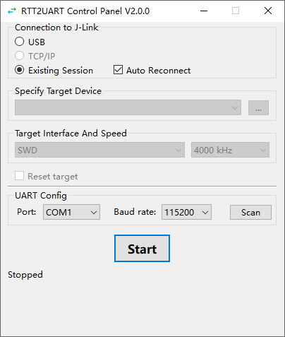

# #15 taskbar minimize acceptance

The [Agent Brief](https://github.com/tianxiaoMCU/RTT2UART/issues/15#issuecomment-6688876894)
is the acceptance contract. Runs began on 2026-11-06 and finished on 2026-11-07
(Asia/Shanghai). The implementation, controlled regressions and Windows package
window checks passed. No remote push or issue update was performed.

## Candidate and method

- Source commit: `53617e93fded87bd7ec670bfc664564ee0994658`.
- EXE SHA256: `73329d34588a0772459ed001d49067679b3285710b74f6fd15f0002f0c5ef271`.
- Windows 10 build 19045, AMD64; Python 3.12.13, PySide6 6.6.1,
  PyInstaller 6.22.3. Full build environment and source hashes are in
  [evidence.json](./evidence.json).
- Tracked inputs were committed during build. The only dirty-state entry was
  the pre-existing, untracked engineering assessment, excluded from packaging.
- Used the [owned acceptance launcher](../../packaging-smoke.md#owned-acceptance-launcher)
  with new isolated directories for each lifetime. Test window PIDs were matched
  to the copied EXE paths using read-only process metadata before interaction.
- agent-desktop 1.2.0 invoked native title-bar, taskbar and X controls headlessly.
  User explicitly authorized the two additional headed Alt+F4/Escape checks.
  Every action reported unverified delivery; independent observations below,
  rather than the action return alone, establish the result. No blind retries.

## Observed results

| Check | Result |
| --- | --- |
| Title bar and layout | Minimize enabled, maximize disabled, X available; icon, fixed layout and labels rendered normally |
| Three minimize/restore cycles | Title-bar Minimize entered Windows minimized state; exact copied EXE retained one taskbar entry; invoking that entry restored the same PID `41940` and window `w-30150268` every time |
| Idle modes | First cycle used USB; next two used Existing Session. Auto Reconnect and mode-specific enabled states remained correct; status stayed Stopped |
| X exit | Same window closed normally, launcher exit code 0 |
| Alt+F4 exit | Fresh isolated EXE, PID `5304`, window `w-10684800`; actual scoped key input closed normally, exit code 0 |
| Escape exit | Fresh isolated EXE, PID `54216`, window `w-58394454`; actual scoped key input closed normally, exit code 0 |
| Cleanup, all three lifetimes | No app windows or owned processes remained; original ACL restored; all five copied package files unchanged; no cleanup errors; exactly the six historical settings keys saved |

## Controlled regression and review

`scripts/check.py` passed: **102 tests**, strict mypy on **9 source files**,
dependency consistency, compilation, evidence integrity and local document links.
The 20 Qt window tests reuse the real Bridge with controlled external I/O.
The initial minimize-capability test failed on the baseline, then passed with
the single Qt flag enabled.

Window tests cover idle/Starting/both connected modes/Reconnecting/Stopping/
Stop incomplete; both directions continue while minimized. Boundary observations
check no extra serial/endpoint/probe open or explicit Target reset from window
actions. Restored recovery status retains 17 observed discarded bytes; default
recovery-off loss remains terminal in both modes. Closing while minimized and
Escape during delayed cleanup still wait for release with restart disabled.
Existing bridge, USB recovery, close and cleanup-failure tests also passed.

Independent Standards and Spec code reviews against
`1aeb571b4b4d6a84587ec3b6f658d074bc92daad` reported **0 findings on each axis**.
Temporary full logs/UI trees are under ignored `build/`; this record retains
candidate identity, decisive app-only projections and launcher cleanup results.

## Limits

Packaged runs did not press Start or request a probe/Target connection. Existing
startup serial Scan can briefly open enumerated ports. Actual exit-key checks
were idle; active and delayed cleanup uses controlled Qt/Bridge evidence.
Minimized transfer/recovery is controlled-fixture evidence, not a new hardware
acceptance run. No new clean-host, driver, Target, throughput or release
compatibility conclusion is claimed.
