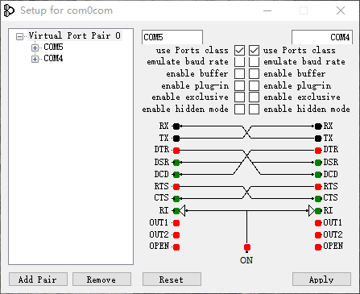
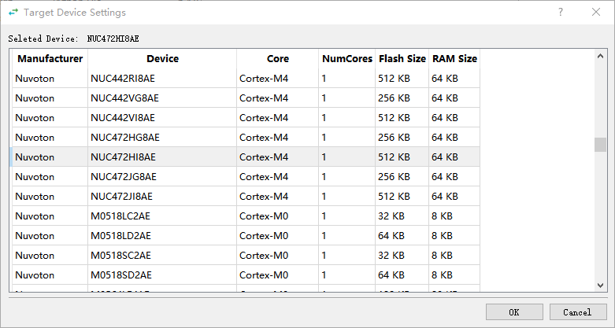
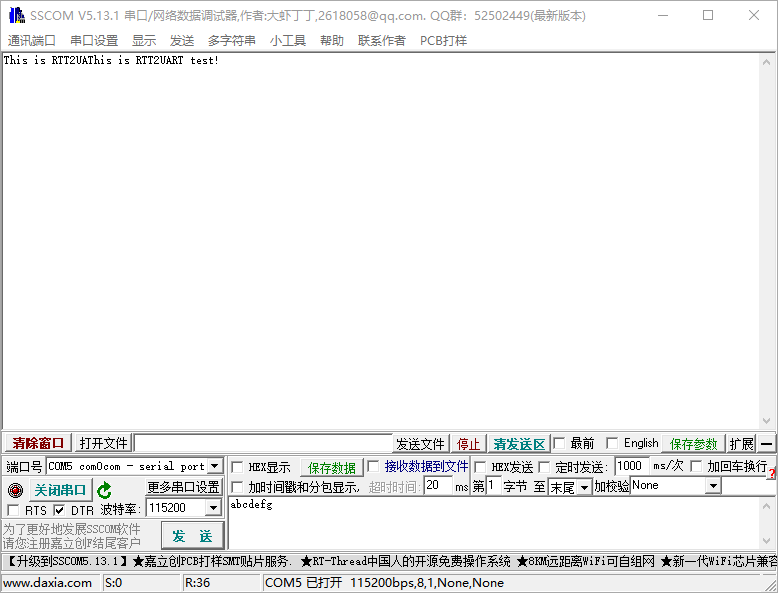
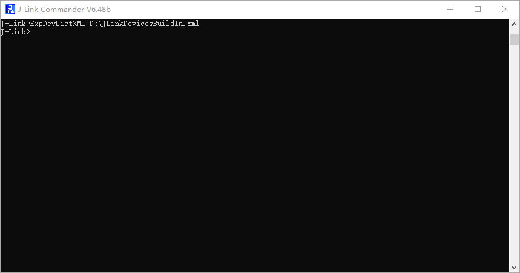

# Getting started

[Project overview](../README.md) | [Development](./development.md) | [Architecture](./architecture.md) | [Glossary](../GLOSSARY.md)

This guide walks an embedded developer through the Windows workflow: connect a
target through a USB J-Link probe, receive RTT output in a serial application,
and send data back to firmware that handles RTT input.

## Before you begin

Prepare the following:

| Item | What you need |
| --- | --- |
| Windows host | A writable application directory and permission to install the required probe and virtual serial port drivers |
| RTT2UART | The extracted release package, or a source checkout prepared using the [development guide](./development.md#run-from-source) |
| J-Link software | A discoverable J-Link runtime library and J-Link Commander (`JLink.exe`); installing Python dependencies alone does not provide them |
| Probe and target | A USB J-Link connection to the correct target debug interface, with target power and wiring already checked |
| Target firmware | Working RTT output; an RTT input handler is also required to test host-to-target traffic |
| Virtual serial ports | A connected virtual COM port pair, such as COM4 and COM5 |
| Serial application | A terminal or existing tool that can open the other endpoint of that pair |

RTT2UART does not install target firmware or configure its RTT buffers. Confirm
the firmware's RTT setup using your normal J-Link workflow before using the
bridge. The program expects a working local RTT TCP endpoint at
`localhost:19021`; it has no control for selecting an RTT channel or control
block address. The mapping between that endpoint and the target's RTT buffers
belongs to the J-Link session and firmware configuration.

## 1. Prepare the application directory

Download the Windows ZIP from
[GitHub Releases](https://github.com/tianxiaoMCU/RTT2UART/releases) and extract it
to a writable directory. The published `v2.0.0` asset is named
`rtt2uart_v2.0.0.zip`. Keep all files from the package together.

For the current source workflow, the working directory must contain:

- `JLinkCommandFile.jlink`, used to export the device list through Commander.
- `JLinkDevicesBuildIn.xml`, used by the device selector. A successful export can
  refresh it; an existing copy is needed when export fails.

If your package is missing these files, use the matching source version to
prepare a complete directory as described in [Packaging](./development.md#package-for-windows).
Do not assume that a single executable contains these external files.

Launch the program with its extracted directory as the working directory. In
PowerShell, change to that directory and run the executable supplied in the
package. For a build named `rtt2uart.exe`, for example:

```powershell
.\rtt2uart.exe
```

Only one application instance is intended to run at a time. If no window
appears, check whether RTT2UART is already running.

## 2. Create a virtual COM port pair

Install a virtual serial port tool, such as the
[com0com tool referenced by the original README](http://com0com.sourceforge.net/),
and create a connected pair. The example below uses **COM4 for RTT2UART** and
**COM5 for the serial application**; use the actual names on your host.



Each application opens a different endpoint. Close other programs that hold
either endpoint before selecting it. RTT2UART's **Scan** briefly opens and
closes enumerated serial ports and lists only those it can open.

## 3. Configure the USB connection

1. Select **USB** under **Connection to J-Link**.
2. If you need a specific probe, select **Serial NO** and enter its serial
   number. Otherwise, probe selection is delegated to the J-Link runtime.
3. Under **Specify Target Device**, click **...**, select the exact target
   device, and confirm with **OK**. Selecting a row populates the device choice.
4. Set **Target Interface And Speed** for your actual wiring and target. On a
   first run without saved settings, the GUI selects **SWD** and **4000 kHz**.
   These are application defaults, not a recommendation for every target.
5. Choose whether to enable **Reset target**. Enable it only when resetting the
   target is appropriate for the session; the USB startup path requests a reset
   with `halt=False` before its target `connect()` call.



The interface list includes JTAG, SWD, cJTAG, and FINE, but the current cJTAG
branch passes no concrete interface value. The list does not establish that
every interface is usable with your probe and target.

## 4. Select the serial endpoint and start

1. Click **Scan** and select the RTT2UART endpoint, **COM4** in this example.
2. Choose a baud rate. The first-run GUI default is **115200**. Configure the
   peer serial application consistently with the virtual port driver's
   requirements; use 115200 for this example.
3. Click **Start**. The button changes to **Stop** if initial startup succeeds.
4. Open **COM5**, the other endpoint, in the serial application.

The serial baud rate is a host serial-port setting. It does not set the RTT data
rate or the J-Link debug-interface speed. RTT2UART leaves the other serial
format and flow-control properties at the serial library's defaults.

The **Stop** label shows that initial startup returned successfully. Confirm
actual traffic in the next step; worker-thread failures do not automatically
update the button.



The screenshots are historical workflow examples. Available controls and their
layout can differ from the version shown.

## 5. Verify each direction

### Receive target output

Have the firmware emit a known RTT message, such as a diagnostic counter or
startup message. Confirm that the expected message appears in the serial
application on COM5. Ensure the firmware is running and that the message is
emitted after the bridge is connected.

### Send data to the target

Use a command that the target firmware already accepts through RTT input.
Configure the serial application's encoding and line endings for that command,
send it through COM5, and confirm a specific response or target-side effect.
RTT2UART does not add line endings or interpret commands.

Record the two results separately. Receiving output proves the receive path;
it does not prove that the firmware consumes RTT input. If no input handler is
available, record the send test as **not performed** rather than passed.

Click **Stop** when finished, then close the serial application. Stop the
bridge before changing connection mode or connection parameters.

## Use an existing J-Link session

Choose **Existing Session** when another local J-Link application owns the
probe connection and provides the RTT endpoint.

1. Start and configure the external J-Link session. Confirm that it provides
   the intended target's RTT data at `localhost:19021`.
2. Start RTT2UART. A discoverable J-Link runtime is still required because the
   GUI creates a J-Link object during startup, even in this mode.
3. Select **Existing Session**. The target device, debug interface, debug
   speed, and reset controls are disabled; the external session owns those
   choices.
4. Select the bridge's COM endpoint and baud rate. Choose **Auto Reconnect** if
   you want the limited reconnection behavior described below.
5. Click **Start**, open the paired endpoint in the serial application, and
   verify both directions as above.

Auto Reconnect is selected by default but applies to Existing Session. After
an established socket reports a clean end of stream, the bridge schedules a
reconnection attempt after 0.5 seconds. Failed retries are scheduled again
after 1 second; connection time adds to these delays. A failed initial
connection still reports an error instead of starting this retry loop.

This mechanism reconnects the local TCP socket and starts forwarding threads.
It does not reopen a lost serial port, reconnect the probe, or guarantee
recovery from socket exceptions or USB removal. Data continuity during an
interruption is not guaranteed. See [Reconnect behavior](./architecture.md#reconnect-behavior)
for the implementation boundary. Stopping Existing Session closes the bridge's
resources without closing the externally owned probe session.

## Refresh the target device list

On Windows, application startup attempts to run J-Link Commander with
`JLinkCommandFile.jlink` to export `JLinkDevicesBuildIn.xml` into the working
directory. A successful export is the normal refresh path.

If a target is missing:

1. Check that the installed J-Link software knows the exact target model.
2. Check that `JLink.exe` is present alongside the discovered J-Link library and
   that the command file and working directory are writable/available.
3. Close RTT2UART. From its working directory, run Commander from your J-Link
   installation to repeat the export. Replace the example path below with the
   path to your installed `JLink.exe`:

   ```powershell
   & 'C:\path\to\JLink.exe' -CommandFile .\JLinkCommandFile.jlink
   ```

4. Confirm that the XML was created, then restart RTT2UART and reopen the
   device selector.

If automatic export fails, the program logs the error and the selector uses
the XML already in the working directory. It does not search other locations
for a replacement. Exporting manually is a fallback, not a requirement after
every successful startup.



## Troubleshooting

| Symptom | Check or next action |
| --- | --- |
| `Find jlink dll failed !` | Install or repair the J-Link runtime and check its discoverability and architecture compatibility with the program. Existing Session has the same startup requirement. |
| `Can not find device database !` | Check the working directory and `JLinkDevicesBuildIn.xml`; follow the refresh steps above. |
| `Please selete the target device !` | Select an actual device row and confirm it before starting USB mode. The spelling shown here matches the current error text. |
| Expected COM port is missing from Scan | Confirm that the driver created the port and that another program has not opened that endpoint. Retry Scan while stopped. |
| Serial port cannot be opened | Check the selected endpoint, permissions, and other programs using it. RTT2UART and the serial application must use different endpoints of the pair. |
| `Connect or config RTT server failed` | Confirm that the intended local J-Link session exposes RTT on `localhost:19021`. For an externally owned session, use Existing Session. Changing the serial baud rate does not repair this TCP connection. |
| Start fails and controls remain disabled | Close and reopen RTT2UART before retrying. The current startup error path does not consistently restore controls or roll back partial resources. |
| Button shows Stop but data has stopped | Check target execution, the RTT session, and both COM endpoints. Worker failures do not reliably reach the GUI. Stop and restart the bridge, or close and reopen it if needed. |
| Output is received but target ignores sent data | Verify the firmware's RTT input handler, the session's buffer mapping, and the command's encoding and line endings. |
| Settings appear to change after moving the program | Settings are read from the current working directory; launch consistently and recheck the selected ports. |
| No new window appears | Check for an already running RTT2UART process; the GUI entry point uses a single-instance guard. |

For diagnostic output, run from a console using the
[source instructions](./development.md#run-from-source) or build without
`--noconsole`. The code configures Python logging but does not configure a log
file. A console-free executable may not expose these messages.

When reporting a problem, include the source revision or release asset name,
Windows/Python versions where applicable, J-Link software and probe versions,
target model and firmware, connection mode, COM pair, settings, exact error,
and which transfer direction failed. Use the
[repository issue tracker](https://github.com/tianxiaoMCU/RTT2UART/issues).
