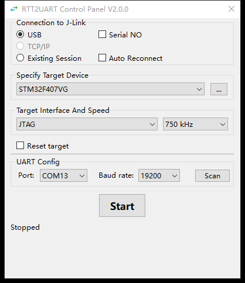
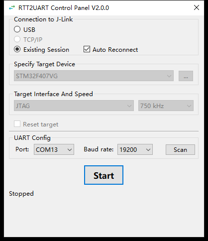
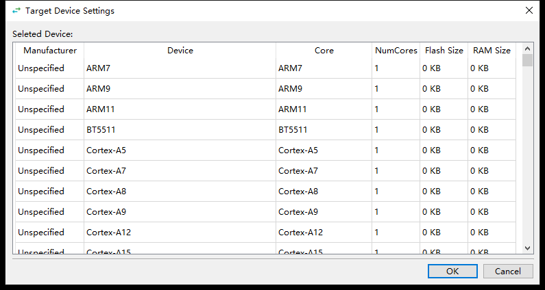

# Windows compatibility and package smoke

This is the reproducible #12 checklist for the final combined #7 revision.
A build, source Qt test, packaged launch, and hardware transfer are separate results.
Do not promote a partial result to a release pass.

For the new integrated #13 candidate, use the
[acceptance matrix and evidence](./integration-acceptance.md). The historical
#12 EXE checks below do not certify a newly built binary.

## Build and identify the candidate

Use the pinned runtime dependencies in `requirements.txt`. Build-tool pins are
separate in `requirements-build.txt`; installing them does not require a runtime
upgrade. From the repository root:

```powershell
.\.venv\Scripts\python.exe -m pip install -r requirements-build.txt
.\.venv\Scripts\python.exe -m pip check
.\.venv\Scripts\python.exe scripts/package_windows.py
```

Keep `dist/windows/rtt2uart.exe`, `JLinkCommandFile.jlink`,
`JLinkDevicesBuildIn.xml`, `LICENSE`, and `build-environment.json` together.
Keep the J-Link runtime and Commander installed separately; they are not bundled.
The virtual COM driver and pair are external prerequisites for transfer tests.
The compiled Qt resources are imported by the entry point.

The build record identifies the revision, dirty state, source SHA-256 values,
EXE SHA-256, Python/Windows/architecture, runtime packages, and build tools.
Do not edit build inputs during the build. On a final release candidate require
clean source, retain the record, and rerun the checks below on that exact EXE.
Never package another user's `settings` file.

## Source compatibility checks

```powershell
.\.venv\Scripts\python.exe -X faulthandler -m unittest tests.test_main_window -v
.\.venv\Scripts\python.exe -m mypy --strict rtt2uart.py usb_transport.py scripts/package_windows.py
.\.venv\Scripts\python.exe -X faulthandler -m unittest discover -s tests -v
```

The GUI tests use the real Qt event loop and Bridge, with controlled external
I/O. They cover A01/A09/A15/A22/A23/A24/A25: mode-specific readiness, two-way bytes,
responsive delayed operations, close/restart exclusion, recovery/discards,
GUI-thread label delivery, per-mode defaults, and legacy settings/history.
The fixtures explicitly destroy closed Qt windows between tests/reopens.
These checks do not validate a real COM driver, probe, or frozen executable.

## Background GUI automation

Use **agent-desktop in headless mode** as the default for automated Windows EXE
acceptance. Read its installed skill and platform guide before operating the app.
The owned launcher below manages process lifetime and cleanup; agent-desktop
observes and operates the native GUI. Keep both scoped to the isolated test run.

1. Identify the test window with `list-windows --app rtt2uart.exe`. Match its PID
   to the copied test EXE at `<run>/program/rtt2uart.exe` using read-only process
   metadata. An app-name match alone is insufficient when another instance exists.
   Bind observations to the returned window ID with `--window-id`; never pick a
   user's unrelated window just because it has focus or the same title.
2. Use background semantic actions on qualified refs from that window's current
   snapshot or scoped `find` result. Default headless operation requires no focus
   request, cursor movement, keyboard synthesis or clipboard use. Leave the user's
   foreground app, window placement and work surfaces alone. The application may
   still present its own dialogs; headless delivery is not a guarantee that it
   never activates itself.
3. After opening a selector/dialog, refresh the window inventory, verify the same
   test process and bind its new window ID before continuing. For a large device
   table, prefer scoped `find` by exact name/native ID over a full accessibility
   dump. Use application-window screenshots when visual state adds evidence.
4. Reobserve after each UI change and use `wait` for asynchronous completion.
   Read the action disposition: an unverified delivery requires state inspection,
   not a repeated click. Retry only when the reported disposition says it is safe.
   Count a GUI check as passed only after the expected value/state is observed.
5. Foreground activation or physical mouse/keyboard input requires explicit user
   authorization covering that interaction. If it is missing, explain which check
   needs the foreground and ask before proceeding. A headless failure does not
   authorize automatic escalation to `--headed`, focus/coordinate input or a
   different tool's physical-input fallback. Keep unavailable checks recorded as
   unverified until they can be completed within the authorized scope.

For example, replace the placeholder below with the verified inventory result:

```powershell
agent-desktop list-windows --app rtt2uart.exe
agent-desktop snapshot --app rtt2uart.exe --window-id '<returned-window-id>' -i --compact
```

PowerShell ref arguments must be quoted, such as `'@<snapshot-id>:e1'`. Closing
the test app must remain scoped to its verified window/process; do not close
every same-named app. Retain the observed results and any foreground/tool limits
with the candidate identity. Historical UIA/keyboard procedures later in this
document describe earlier evidence; this workflow is the current automation entry.

## Owned acceptance launcher

For a new Windows EXE run, use the tracked launcher instead of a one-off
`Popen.wait()` wrapper. It requires Python 3.12 and PowerShell 7 (`pwsh` on PATH),
already available in the documented development/Windows CI setup.

```powershell
.\.venv\Scripts\python.exe scripts/accept_windows.py --package dist/windows --output build/acceptance/run-01 --timeout 1800
```

The output directory must be new: previous results are never overwritten. The
launcher copies only the five named package files into `program/`, keeps settings
in `work/` and redirects LOCALAPPDATA to `user/`. It saves the program directory's
original ACL in `program-acl.sddl`, then applies a current-user write-deny ACL to
that disposable copy. It never changes the source package/installation ACL or
copies an operator's settings. The retained run directory includes the package
copy and can be large; keep it under ignored `build/` during acceptance.

After launch, follow [background GUI automation](#background-gui-automation) for
the applicable GUI checks and close the test window normally. The
launcher itself supplies no mouse/keyboard input and does not perform any bridge
Start or hardware operation. Application startup retains its existing serial Scan
behavior. A zero launcher exit code means only normal process exit, successful
cleanup and unchanged package files; it does not certify the GUI or release gate.
The run is one application lifetime; a fresh output directory starts with fresh
settings/cache rather than claiming a persistence/restart test.

`result.json` records the outcome, exit code when available, file hashes, process
cleanup, ACL restoration and cleanup errors. `process.log` captures child output.
Timeout returns 124, Ctrl+C interruption returns 130, and other failures return 1;
cleanup failure can never become a passed result. The result is written before
setup and atomically replaced after cleanup, including failed setup/launch runs.
The timeout starts when the owned supervisor is released to launch the EXE; ACL
helper calls have separate 30-second deadlines. After normal launcher exit, a
five-second grace period allows its job accounting/children to settle. Remaining
descendants are forcibly cleaned up and the run fails.

A [Windows Job Object](https://learn.microsoft.com/en-us/windows/win32/procthread/job-objects)
contains the supervisor and its children, including the two-process one-file EXE.
The supervisor uses the base interpreter directly, avoiding the virtual-environment
redirector, and waits for its command until job assignment succeeds. Cleanup acts
on that job rather than terminating every process named `rtt2uart.exe`; unrelated
instances remain untouched. Normal exit, timeout, exceptions and Ctrl+C share the
same cleanup path. ACL readback compares the original owner/group, protection
and ACEs, ignoring only Windows' automatically stamped DACL `AI` flag.

Force-killing the launcher or losing power cannot execute Python's ACL-restoration
code. The job is configured to terminate its owned children on handle closure, but
the copied program directory may retain its write-deny ACL. Restore that isolated
copy from its saved `program-acl.sddl` with `Set-Acl` before reusing/removing it; a
failed restoration/readback is recorded as a cleanup failure. Original
installations and operator settings are outside this cleanup scope.

The shared checks run hardware-free regressions at `run_acceptance()` using real
controlled parent/child processes and temporary directories. They cover timeout,
normal exit, interruption, failed launch, orphaned descendants, unrelated-process
exclusion, ACL restoration/failure and prior-result preservation. These tests do
not open the RTT2UART GUI or require J-Link hardware. The old local
`build/issue14/launch_package.py` entry point delegates to this tracked launcher;
historical evidence remains unchanged.

## Packaged interactive checklist

Use a disposable writable deployment directory and launch with that directory
as the working directory. Preserve any real settings before testing; use a copy
of an existing settings file or a known six-key legacy fixture. No migration is
required. The historical `buadrate` key spelling is retained. Only device history
and the five selection indices are persisted; mode, reset, probe serial number,
and Auto Reconnect remain outside persistence. Recheck the COM selection because
its saved index can refer to a different port after enumeration changes.

```powershell
Push-Location .\dist\windows
try { .\rtt2uart.exe } finally { Pop-Location }
```

This direct-launch example is for manual checks. Automated runs use the owned
launcher and background GUI workflow above.

| Check | Expected result |
| --- | --- |
| Initial launch | Main window, icon, labels and controls render; no missing-module/resource dialog |
| Legacy settings | Target history, selected Target, interface, speed, baud rate, and available COM index load |
| Target selection | New selection enters history; selecting an existing history item updates the combo; Cancel or empty OK leaves the choice unchanged |
| USB idle | USB selected initially; Auto Reconnect off; Target/interface/speed/reset controls available |
| Existing Session idle | Auto Reconnect on; Target/interface/speed/reset controls disabled; serial choices still available |
| Unsupported controls | Remote-probe TCP/IP disabled; no selectable RTT channel or minimization feature added |
| Second instance | Launch the same EXE again while the first is open; the second exits without another window |
| Save and reopen | Change supported saved selections, close normally, reopen; choices/history remain; USB recovery defaults off again |
| First-start failure | Use an unavailable test port/endpoint; no false ready state or infinite retry; clear failure and manual restart after cleanup |
| Both modes, controlled setup | Starting then the correct ready text; controls locked; Stop/close responsive and cleanup complete before restart |
| Recovery and close | Exercise Existing Session recovery and optional USB recovery; counts and Stop incomplete have their documented meanings |

Use actual known-safe hardware/COM fixtures for the last two rows when available;
otherwise mark them pending and retain the automated evidence separately. A
package test on a development host is not clean-host deployment validation.

Issue#13 has an [operator-approved qualification dated2026-11-05](./evidence/issue13-deployment-2026-11-05/gate-qualification-proposal.md):
the recorded separate Windows11/J-Link7.54d deployment/dependency-isolation run
satisfies that ticket's remaining deployment gate. CubeIDE/NI remain installed;
this exception does not claim a development-software-free Windows pass or
generalize to another candidate/host/runtime.

## Recorded result — #12, 2026-10-25

Candidate built from `d656150042d6a2017510febbf6fa9ee8294af7a4` plus the #12
working-tree changes; the emitted manifest binds the precise runtime sources.
No release was published. Candidate EXE SHA-256:
`93294b5ada72536623014bba23d1ad59f0906016c5c4a448cc10871751fc234d`.

- Windows 10 build 19045, AMD64; CPython 3.12.13, 64-bit, MSC 1944.
- PySide6 / Addons / Essentials / shiboken6 6.6.1, pylink-square 1.2.0,
  pyserial 3.5, unchanged from the runtime baseline.
- PyInstaller 6.22.3, hooks-contrib 2026.9; altgraph 0.17.5, packaging 26.3,
  pefile 2024.8.26, pywin32-ctypes 0.2.3, setuptools 84.2.1.
- Installed J-Link x64 DLL reported 7.54d. No probe was opened and no Target
  traffic was initiated by this smoke check.
- **Build passed:** one-file/windowed EXE plus the required companion files and
  environment manifest. The Windows Qt platform plugin was collected. Build
  warnings about macOS-only serial framework imports do not establish macOS support.
- **Launch and settings load passed:** the actual packaged process exposed the
  main window and a readable Windows accessibility tree. A protocol-4 legacy
  fixture loaded `STM32F103C8` from a two-item history, SWD, 600 kHz and 9600 baud.
  The tree exposed Start, Scan, both supported mode controls, disabled TCP/IP,
  and Stopped. No usable COM port was selected in this environment.
- **Single-instance passed:** launching a second copy while the first window
  existed caused that second process to exit; only the original window remained.
- **Interactive/visual smoke pending:** Windows capture returned `FrameArrived
  timed out` and `window capture timed out`; indexed input returned `coordinate
  input geometry is unavailable`. Keyboard input did not produce an observable
  focus change. Actual EXE icon/layout rendering, switching modes, editing and
  normal close/reopen were therefore not verified. The idle test process was
  terminated after inspection; that is not evidence of normal shutdown.
- **Hardware and clean-host deployment pending:** no real virtual COM transfer,
  USB probe/Target traffic, native reset/halt observation, throughput, or recovery
  fault injection. #13 must rerun the complete matrix on the combined revision.

At the end of the 2026-10-25 run, package acceptance remained pending. The
2026-10-30 follow-up below completes the interactive smoke subset; the earlier
capture failure remains a historical observation.

## Interactive follow-up — #12, 2026-10-30

**Package GUI compatibility smoke passed.** The same EXE SHA-256 recorded above
was verified and copied with its companions into an isolated writable deployment.
No application code, runtime dependencies, or original saved settings changed.
The checkout was at `25ac209`; this was a retest of the existing binary, not a new
build or release. The host remains Windows 10 build 19045 / AMD64.

Windows UI Automation (`System.Windows.Automation`) discovered controls by the
running deployment's process and AutomationId, read their values, and used
SelectionItem/Toggle/Invoke/Window patterns. Qt's combo-box selection pattern
changed only a highlighted list item; Value/Invoke calls did not commit a choice.
The successful path expanded the combo through UIA, identified its actual popup
window, and posted Home/Down followed by Enter to that window. Every choice was
read back before counting it as a pass. This uses no guessed screen coordinates
and does not invoke application Python internals.

Visual evidence came from Win32 `PrintWindow` with the full `GetWindowRect`
dimensions, inspected after capture. It demonstrates the actual packaged GUI;
it does **not** establish that the earlier Windows.Graphics.Capture failure was
repaired. Full snapshots and observed values are retained in
[result.json](./evidence/issue12-2026-10-30/result.json).

| Check | Observed result |
| --- | --- |
| Main window/resources | Title, arrow icon, labels, status and controls rendered correctly |
| Legacy settings | Two-item Target history loaded STM32F103C8, SWD, 600 kHz, 9600; COM13 was enumerated/selected on this host |
| Mode switching | Existing Session selected with Auto Reconnect on and Target/interface/speed/reset controls disabled; USB restored editable controls and Auto Reconnect off; TCP/IP stayed disabled |
| Edit and save | Changed Target to STM32F407VG, interface to JTAG, speed to 750 kHz and baud to 19200; COM13 remained selected |
| Normal close/reopen | UIA WindowPattern.Close exited both package processes without forced termination; reopening restored all changed selections |
| Persistence scope | Saved file retained exactly the six historical keys; USB Auto Reconnect was on before close and off after reopening |
| Target selector | Real companion catalog rendered; Cancel and empty OK both preserved STM32F407VG |
| Second instance | Second launch exited with code 0 while the original main window remained |
| Close in both idle modes | Normal close succeeded from USB and Existing Session; reopening after Existing Session restored USB/off defaults; all test processes were normally closed at the end |







COM13's physical/virtual topology was not established. No bridge Start or Target
reset was requested; startup's existing serial Scan can briefly open enumerated
ports. JTAG and the other choices above are test values, not Target connection
recommendations. Actual transfer in either mode, active-run recovery/cleanup,
native reset/halt effects, throughput, and clean-host deployment remain #13's
hardware/release gate. Source tests already cover controlled lifecycle failures;
this follow-up does not replace or broaden that evidence.

To repeat the GUI smoke, use the isolated-deployment checklist above, compare
the manifest/EXE hash, read the same control values before and after normal close,
and retain screenshots and the process-exit observation. Use a fresh settings
fixture rather than changing an operator's saved selections. UIA calls returning
success alone are insufficient: verify the resulting GUI value and reopen it.

## Baseline and rollback

The pre-#12 baseline is `d656150042d6a2017510febbf6fa9ee8294af7a4` (#11 integrated).
The pre-lifecycle baseline is `96609b324cd52a00ab15fddc8f4461e4404b744a`.

1. Stop the bridge and wait for Stopped (or clean Failed); close normally. If
   Stop incomplete remains, resolve the outstanding operation before replacement.
2. Back up the deployment directory and settings. Retain the failing EXE,
   environment manifest, exact error and hardware configuration for comparison.
3. Restore a separately retained, known-tested deployment, or create a separate
   source checkout without resetting the current work:

   ```powershell
   git worktree add --detach ..\RTT2UART-before-12 d656150042d6a2017510febbf6fa9ee8294af7a4
   ```

4. Build/run that checkout with its recorded dependencies and matching companions.
   Verify settings and both directions on the intended setup before use. A source
   baseline alone is not a certified release binary.

Never silently route a failing direct-RTT USB run through `localhost:19021`.
If deliberately using Existing Session instead, select it explicitly and verify
which external session owns the endpoint. Record it as a different mode/test.
